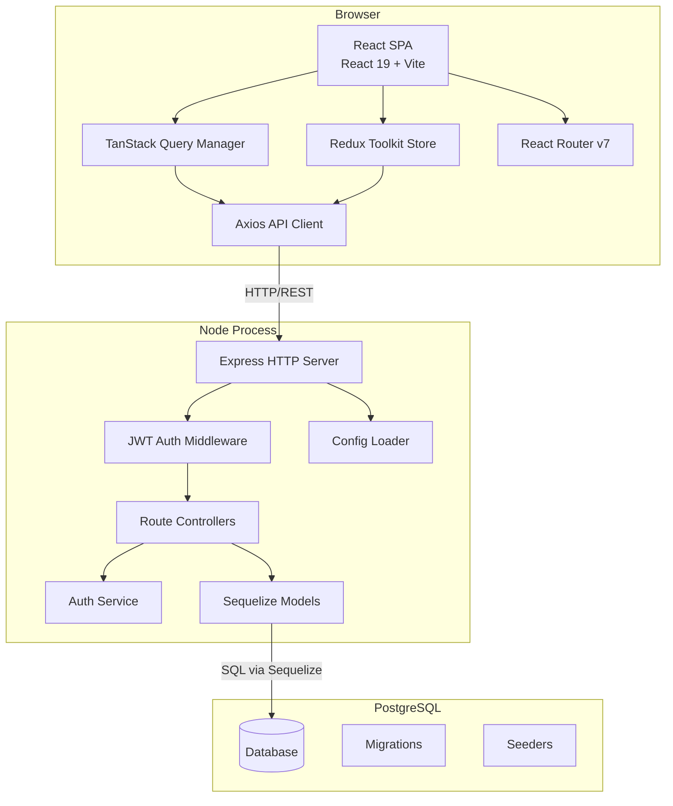
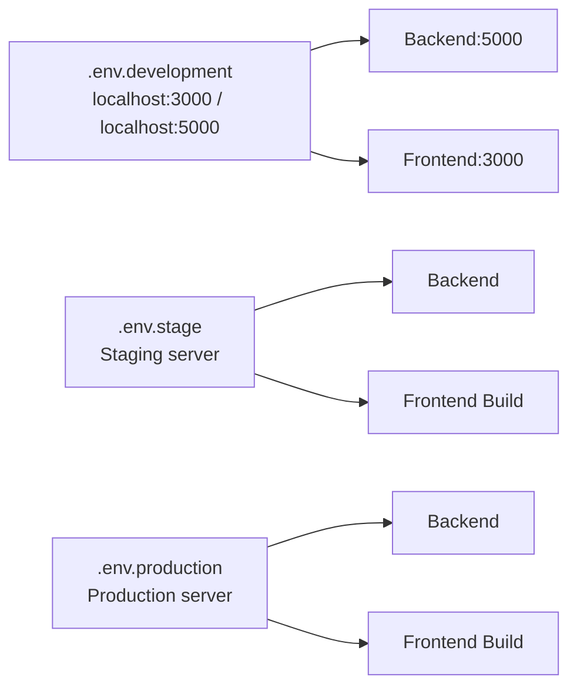

# Design Document — Full-Stack App Setup

## Overview

This document describes the technical design for scaffolding a production-ready full-stack web
application. The system is organized as a **monorepo** containing two packages:

- **Frontend** — React 19 + TypeScript + Vite SPA, using Material UI, Redux Toolkit, TanStack
  Query, Axios, and React Router v7.
- **Backend** — Node.js + Express + TypeScript REST API, using Sequelize ORM against PostgreSQL,
  JWT authentication, and environment-driven configuration.

The design targets three deployment environments (`development`, `stage`, `production`) and
enforces consistent code quality with ESLint, Prettier, and Husky pre-commit hooks across the
entire monorepo.

---

## Architecture

### High-Level System Diagram



### Deployment Architecture



### Monorepo Structure

```
/
├── package.json              # Root — workspaces: ["frontend", "backend"]
├── .gitignore
├── .prettierrc
├── eslint.config.js
├── .husky/
│   └── pre-commit
├── frontend/
│   ├── package.json
│   ├── vite.config.ts
│   ├── tsconfig.json
│   └── src/
│       ├── assets/
│       ├── components/
│       ├── pages/
│       ├── hooks/
│       ├── store/
│       │   └── index.ts       # Redux store + RootState + AppDispatch
│       ├── services/
│       │   └── apiClient.ts   # Axios instance with interceptors
│       ├── routes/
│       │   └── index.tsx      # Route definitions (public + protected)
│       ├── types/
│       └── utils/
├── backend/
│   ├── package.json
│   ├── tsconfig.json
│   └── src/
│       ├── config/
│       │   └── index.ts       # Config Loader
│       ├── controllers/
│       │   └── authController.ts
│       ├── middlewares/
│       │   ├── authMiddleware.ts
│       │   └── errorMiddleware.ts
│       ├── models/
│       │   └── index.ts       # Sequelize model registry
│       ├── routes/
│       │   ├── index.ts
│       │   └── authRoutes.ts
│       ├── services/
│       │   └── authService.ts
│       ├── types/
│       └── utils/
│   └── database/
│       ├── config/
│       │   └── config.js      # sequelize-cli config
│       ├── migrations/
│       └── seeders/
└── docs/
    ├── ARCHITECTURE.md
    ├── SETUP.md
    ├── API.md
    └── AUTH.md
```

---

## Components and Interfaces

### Frontend Components

#### 1. Config Loader (Vite Environment Variables)

Vite exposes `VITE_*` variables at build time via `import.meta.env`. A thin wrapper at
`src/utils/env.ts` reads and validates these values at startup.

```typescript
// src/utils/env.ts
export const API_BASE_URL: string = import.meta.env.VITE_API_BASE_URL;
```

#### 2. Axios API Client (`src/services/apiClient.ts`)

A singleton Axios instance with two interceptors:

- **Request interceptor** — attaches `Authorization: Bearer <token>` when an Access_Token exists
  in `localStorage`.
- **Response interceptor** — on HTTP `401`, attempts a single token refresh via
  `POST /api/auth/refresh`, retries the original request with the new token, and redirects to
  `/login` if the refresh also fails.

```typescript
interface TokenPair {
  accessToken: string;
  refreshToken: string;
}

// Interceptor logic (pseudo-code)
// REQUEST: if accessToken exists → set Authorization header
// RESPONSE: on 401 → call refreshToken() → retry once → on failure → clearTokens() + navigate('/login')
```

#### 3. Redux Store (`src/store/index.ts`)

Configured with `configureStore`. Exports `RootState` and `AppDispatch` types. At minimum
contains an `authSlice` holding token state.

```typescript
interface AuthState {
  accessToken: string | null;
  isAuthenticated: boolean;
}
```

#### 4. React Router (`src/routes/index.tsx`)

Routes are divided into two groups:

- **Public routes** — accessible without a token (e.g., `/login`, `/register`).
- **Protected routes** — wrapped in a `ProtectedRoute` guard component that reads the
  Access_Token, checks its `exp` claim against `Date.now()`, and redirects to `/login` if
  absent or expired.

```typescript
interface ProtectedRouteProps {
  children: React.ReactNode;
}
// Reads accessToken from store/localStorage, decodes JWT exp, redirects if expired
```

#### 5. TanStack Query Provider (`src/main.tsx`)

A single `QueryClient` instance is created at module level and provided via `QueryClientProvider`
wrapping the entire component tree, ensuring unified server-state caching.

---

### Backend Components

#### 1. Config Loader (`src/config/index.ts`)

Reads `.env.<NODE_ENV>` using `dotenv`. Validates all required variables at startup and exits
with a non-zero code if any are missing or if `NODE_ENV` is invalid.

```typescript
interface AppConfig {
  nodeEnv: 'development' | 'stage' | 'production';
  port: number;
  databaseUrl: string;
  jwtSecret: string;
  jwtRefreshSecret: string;
  accessTokenExpiry: number; // seconds
  refreshTokenExpiry: number; // seconds
}
```

Required variables: `NODE_ENV`, `PORT`, `DATABASE_URL`, `JWT_SECRET`, `JWT_REFRESH_SECRET`,
`ACCESS_TOKEN_EXPIRY`, `REFRESH_TOKEN_EXPIRY`.

#### 2. Express Application (`src/app.ts`)

- Registers `express.json()` globally.
- Mounts route handlers under `/api`.
- Registers the global error-handling middleware as the last middleware.

#### 3. Auth Service (`src/services/authService.ts`)

Encapsulates all JWT logic:

```typescript
interface AuthService {
  login(email: string, password: string): Promise<TokenPair>;
  refresh(refreshToken: string): Promise<Pick<TokenPair, 'accessToken'>>;
  logout(refreshToken: string): Promise<void>;
  verifyAccessToken(token: string): JwtPayload;
  revokeRefreshToken(token: string): Promise<void>;
  isRefreshTokenRevoked(token: string): Promise<boolean>;
}
```

Token rotation on refresh: the old Refresh_Token is marked revoked (stored in a
`revoked_tokens` DB table or in-memory set for development), and a new one is issued.

#### 4. Auth Middleware (`src/middlewares/authMiddleware.ts`)

Express middleware that:

1. Reads the `Authorization` header.
2. Verifies the Access_Token using `authService.verifyAccessToken`.
3. Attaches decoded payload to `req.user`.
4. Returns HTTP `401` on missing, expired, or malformed tokens.

```typescript
interface AuthenticatedRequest extends Request {
  user?: JwtPayload;
}
```

#### 5. Error Middleware (`src/middlewares/errorMiddleware.ts`)

Global Express error handler (4-argument signature). Logs the full stack trace to `console.error`
and returns:

- HTTP `400` + `{ message }` for JSON parse errors.
- HTTP `500` + `{ message: 'Internal Server Error' }` for all other unhandled errors.

The stack trace is never included in the response body.

#### 6. Health Check Route (`GET /api/health`)

A public route returning exactly `{ "status": "ok" }` with HTTP `200`. No authentication
required.

#### 7. Sequelize Instance (`src/models/index.ts`)

Initializes Sequelize with the connection string from `AppConfig.databaseUrl`. On startup,
calls `sequelize.authenticate()` — logs `"Database connection established"` on success, or
logs the error with host/port details and calls `process.exit(1)` on failure.

---

## Data Models

### Database Tables

#### `users`

| Column       | Type          | Constraints             |
| ------------ | ------------- | ----------------------- |
| `id`         | UUID / SERIAL | PRIMARY KEY             |
| `email`      | VARCHAR(255)  | UNIQUE, NOT NULL        |
| `password`   | VARCHAR(255)  | NOT NULL (bcrypt hash)  |
| `created_at` | TIMESTAMPTZ   | NOT NULL, DEFAULT NOW() |
| `updated_at` | TIMESTAMPTZ   | NOT NULL, DEFAULT NOW() |

#### `revoked_tokens`

Stores revoked Refresh_Tokens to support token rotation and logout revocation.

| Column       | Type         | Constraints                         |
| ------------ | ------------ | ----------------------------------- |
| `id`         | SERIAL       | PRIMARY KEY                         |
| `token_hash` | VARCHAR(512) | UNIQUE, NOT NULL (SHA-256 of token) |
| `revoked_at` | TIMESTAMPTZ  | NOT NULL, DEFAULT NOW()             |
| `expires_at` | TIMESTAMPTZ  | NOT NULL (used for cleanup)         |

### Sequelize Model Definitions (TypeScript)

```typescript
// User Model
interface UserAttributes {
  id: string;
  email: string;
  password: string;
  createdAt?: Date;
  updatedAt?: Date;
}

// RevokedToken Model
interface RevokedTokenAttributes {
  id: number;
  tokenHash: string;
  revokedAt: Date;
  expiresAt: Date;
}
```

### Migration File Naming

```
backend/database/migrations/
  YYYYMMDDHHMMSS-create-users.js
  YYYYMMDDHHMMSS-create-revoked-tokens.js
```

### Sequelize CLI Config (`backend/database/config/config.js`)

```javascript
module.exports = {
  development: { use_env_variable: 'DATABASE_URL', dialect: 'postgres' },
  test: { use_env_variable: 'DATABASE_URL', dialect: 'postgres' },
  production: { use_env_variable: 'DATABASE_URL', dialect: 'postgres' },
};
```

### JWT Payload Structure

```typescript
interface AccessTokenPayload {
  sub: string; // user id
  email: string;
  iat: number;
  exp: number; // iat + ACCESS_TOKEN_EXPIRY seconds
}

interface RefreshTokenPayload {
  sub: string; // user id
  iat: number;
  exp: number; // iat + REFRESH_TOKEN_EXPIRY seconds
}
```

### API Request / Response Schemas

#### `POST /api/auth/login`

Request:

```json
{ "email": "string (required)", "password": "string (required)" }
```

Response `200`:

```json
{ "accessToken": "string", "refreshToken": "string" }
```

Response `401`:

```json
{ "message": "Invalid credentials" }
```

#### `POST /api/auth/refresh`

Request:

```json
{ "refreshToken": "string (required)" }
```

Response `200`:

```json
{ "accessToken": "string" }
```

Response `401`:

```json
{ "message": "Invalid or expired refresh token" }
```

#### `POST /api/auth/logout`

Request:

```json
{ "refreshToken": "string (required)" }
```

Response `200`:

```json
{ "message": "Logged out successfully" }
```

#### `GET /api/health`

Response `200`:

```json
{ "status": "ok" }
```

---

## Correctness Properties

_A property is a characteristic or behavior that should hold true across all valid executions of
a system — essentially, a formal statement about what the system should do. Properties serve as
the bridge between human-readable specifications and machine-verifiable correctness guarantees._

The following properties were derived from testable acceptance criteria. Smoke, integration, and
purely structural criteria are covered by unit/integration tests and are excluded from
property-based testing. Only criteria where input variation genuinely reveals edge cases are
represented here.

**Property reflection summary**: Properties 4 and 5 (auth middleware accept/reject) are
complementary but non-redundant — they cover the two branches of the same guard logic with
different generator profiles. Properties 6 and 7 (refresh token rotation + logout revocation)
test different operations on the same token lifecycle and cannot be merged. Property 3 and the
single-retry property (Property 8) cover client-side vs server-side aspects of the auth flow
and are each unique.

---

### Property 1: API Client attaches Bearer token for any stored Access_Token

_For any_ non-empty Access_Token string stored in the browser's storage, a request made through
the Axios API_Client SHALL include the header `Authorization: Bearer <token>` with the exact
stored token value.

**Validates: Requirements 2.6**

---

### Property 2: Protected Route redirects to `/login` for any expired or absent token

_For any_ JWT whose `exp` claim is earlier than the current UTC time (or when no token is
present), the `ProtectedRoute` component SHALL redirect the user to `/login` without rendering
the protected child component.

**Validates: Requirements 2.10**

---

### Property 3: Error middleware never exposes stack traces in the response body

_For any_ error object thrown inside an Express route handler — regardless of error type,
message, or stack depth — the global error middleware SHALL respond with HTTP `500` and a JSON
body containing only a `message` field; the response body SHALL NOT contain the error stack
trace or any implementation details.

**Validates: Requirements 3.6**

---

### Property 4: Auth middleware allows any valid, non-expired Access_Token

_For any_ Access_Token signed with `JWT_SECRET` whose `exp` claim is in the future, the auth
middleware SHALL call `next()` and attach the decoded JWT payload to `req.user` without
returning an error response.

**Validates: Requirements 5.4**

---

### Property 5: Auth middleware rejects any expired or malformed Access_Token

_For any_ token string that is either expired (exp < now), malformed (not a valid JWT), or
signed with an incorrect secret, the auth middleware SHALL return HTTP `401` with the body
`{ "message": "Unauthorized" }` without invoking the downstream route handler.

**Validates: Requirements 5.5**

---

### Property 6: Token generation produces correctly timed expiry claims

_For any_ successful login, the issued `accessToken` SHALL have `exp = iat + ACCESS_TOKEN_EXPIRY`
and the issued `refreshToken` SHALL have `exp = iat + REFRESH_TOKEN_EXPIRY`, where both expiry
durations are read from environment variables and treated as integers in seconds.

**Validates: Requirements 5.1, 6.8**

---

### Property 7: Refresh token rotation — used token is always revoked

_For any_ valid, non-expired Refresh_Token, calling the refresh endpoint SHALL mark that exact
token as revoked, such that any subsequent call to the refresh endpoint with the same token
returns HTTP `401`.

**Validates: Requirements 5.2**

---

### Property 8: Logout revocation — any valid Refresh_Token becomes unusable after logout

_For any_ valid Refresh_Token, after a successful call to `POST /api/auth/logout`, any
subsequent `POST /api/auth/refresh` using that same token SHALL return HTTP `401`.

**Validates: Requirements 5.6**

---

### Property 9: API_Client performs exactly one refresh attempt on HTTP 401

_For any_ HTTP `401` response received from a protected API endpoint, the Axios response
interceptor SHALL call `POST /api/auth/refresh` exactly once — not zero times, not more than
once — before either retrying the original request (on success) or clearing tokens and
redirecting (on failure).

**Validates: Requirements 5.9**

---

### Property 10: Config Loader reports all missing required variables

_For any_ non-empty subset of the seven required backend environment variables (`NODE_ENV`,
`PORT`, `DATABASE_URL`, `JWT_SECRET`, `JWT_REFRESH_SECRET`, `ACCESS_TOKEN_EXPIRY`,
`REFRESH_TOKEN_EXPIRY`) that is absent at startup, the Config_Loader SHALL log the name of
every missing variable and exit with a non-zero status code without starting the HTTP server.

**Validates: Requirements 6.5, 6.6**

---

## Error Handling

### Backend Error Handling Strategy

| Scenario                         | HTTP Status | Response Body                                       | Logging                                 |
| -------------------------------- | ----------- | --------------------------------------------------- | --------------------------------------- |
| Unhandled route error            | 500         | `{ "message": "Internal Server Error" }`            | Full stack to `console.error`           |
| Malformed JSON body              | 400         | `{ "message": "<parse error description>" }`        | Warning                                 |
| Invalid/expired Access_Token     | 401         | `{ "message": "Unauthorized" }`                     | None (expected)                         |
| Invalid/expired Refresh_Token    | 401         | `{ "message": "Invalid or expired refresh token" }` | None (expected)                         |
| DB unreachable at startup        | —           | Process exits; no HTTP server starts                | Error with host:port to `console.error` |
| Missing env variables at startup | —           | Process exits; no HTTP server starts                | Each missing variable name logged       |
| Invalid NODE_ENV at startup      | —           | Process exits                                       | Invalid value logged                    |

### Frontend Error Handling Strategy

| Scenario                                         | Behavior                                                                 |
| ------------------------------------------------ | ------------------------------------------------------------------------ |
| API returns 401 (Protected Route)                | Interceptor attempts single refresh; on success retries original request |
| Refresh also returns 401                         | Clear both tokens from storage; redirect to `/login`                     |
| Navigation to Protected Route with expired token | `ProtectedRoute` guard redirects to `/login`                             |
| Network error / 5xx                              | TanStack Query handles retry policy; error state surfaced to component   |

### Startup Validation Order (Backend)

1. Validate `NODE_ENV` — if missing or invalid, log and `process.exit(1)`.
2. Load `.env.<NODE_ENV>` via `dotenv`.
3. Validate all required variables — collect all missing names, log them, and `process.exit(1)` if any are missing.
4. Initialize Sequelize and call `sequelize.authenticate()`.
5. If DB fails — log error with host:port and `process.exit(1)`.
6. Log `"Database connection established"`.
7. Start Express HTTP server.

---

## Testing Strategy

### PBT Applicability Assessment

This feature contains significant pure-function logic (JWT generation/validation, config
validation, Axios interceptor logic, route guard expiry checks) that is well-suited to
property-based testing. PBT IS applicable for the components identified in the Correctness
Properties section above.

IaC/configuration/documentation criteria are NOT suited to PBT and are covered by smoke tests
or integration tests.

### Dual Testing Approach

#### Unit Tests (example-based)

Focus on specific behaviors and integration points:

- `GET /api/health` returns `{ "status": "ok" }` with HTTP 200.
- Express server defaults to port 5000 when `PORT` is absent.
- `express.json()` parses request bodies correctly.
- `POST /api/auth/login` returns 401 for invalid credentials.
- `POST /api/auth/logout` returns 200 even for an expired/invalid refresh token.
- DB unreachable: `process.exit(1)` is called with error logged.
- DB reachable: confirmation message is logged before server starts.
- Config Loader loads the correct `.env.<NODE_ENV>` file.

#### Property-Based Tests

Property-based testing library: **[fast-check](https://github.com/dubzzz/fast-check)** (for
both frontend and backend TypeScript).

Each property test SHALL run a **minimum of 100 iterations**.

| Property                                                 | Tag                                                                                                                    |
| -------------------------------------------------------- | ---------------------------------------------------------------------------------------------------------------------- |
| Property 1: API Client Bearer token                      | `Feature: full-stack-app-setup, Property 1: API Client attaches Bearer token for any stored Access_Token`              |
| Property 2: Protected Route redirect                     | `Feature: full-stack-app-setup, Property 2: Protected Route redirects to /login for any expired or absent token`       |
| Property 3: Error middleware no stack trace              | `Feature: full-stack-app-setup, Property 3: Error middleware never exposes stack traces in the response body`          |
| Property 4: Auth middleware accepts valid token          | `Feature: full-stack-app-setup, Property 4: Auth middleware allows any valid, non-expired Access_Token`                |
| Property 5: Auth middleware rejects invalid token        | `Feature: full-stack-app-setup, Property 5: Auth middleware rejects any expired or malformed Access_Token`             |
| Property 6: Token expiry correctness                     | `Feature: full-stack-app-setup, Property 6: Token generation produces correctly timed expiry claims`                   |
| Property 7: Refresh token rotation revokes used token    | `Feature: full-stack-app-setup, Property 7: Refresh token rotation — used token is always revoked`                     |
| Property 8: Logout revokes token                         | `Feature: full-stack-app-setup, Property 8: Logout revocation — any valid Refresh_Token becomes unusable after logout` |
| Property 9: Exactly one refresh attempt on 401           | `Feature: full-stack-app-setup, Property 9: API_Client performs exactly one refresh attempt on HTTP 401`               |
| Property 10: Config Loader reports all missing variables | `Feature: full-stack-app-setup, Property 10: Config Loader reports all missing required variables`                     |

#### Smoke Tests (configuration/structure verification)

Single-execution checks that verify static structure and configuration:

- Root `package.json` has `workspaces: ["frontend", "backend"]`.
- All required `frontend/src/` and `backend/src/` directories exist.
- `frontend/tsconfig.json` has `strict: true`, `target: "ES2020"`, `moduleResolution: "bundler"`.
- `backend/tsconfig.json` has `strict: true`, `outDir: "dist"`, `rootDir: "src"`.
- `vite.config.ts` sets `server.port = 3000` for development.
- `.prettierrc` contains exact required settings.
- `eslint.config.js` references both tsconfig files and includes required rules.
- `.husky/pre-commit` runs `lint-staged`; `lint-staged` config covers correct file patterns.
- `.env.example` files exist at root and `backend/`.
- Documentation files exist: `docs/ARCHITECTURE.md`, `docs/SETUP.md`, `docs/API.md`, `docs/AUTH.md`.
- No literal secrets in source files.

#### Integration Tests

Test real interactions between components, using a test database:

- Run `db:migrate` and verify all migrations apply in order.
- Run `db:seed` and verify seed records are inserted.
- Run `db:migrate:undo` and verify exactly the last migration is rolled back.
- Run `lint` script with a known violation; verify non-zero exit code.
- Run `format` script; verify file content matches `.prettierrc` settings.

### Test Configuration

```typescript
// Example fast-check property test (backend)
import fc from 'fast-check';
import { verifyAccessToken } from '../src/services/authService';
import jwt from 'jsonwebtoken';

// Property 5: Auth middleware rejects any expired or malformed token
test('auth middleware rejects expired tokens', () => {
  // Feature: full-stack-app-setup, Property 5: Auth middleware rejects any expired or malformed Access_Token
  fc.assert(
    fc.property(fc.string(), (tokenString) => {
      // Use arbitrary strings as malformed tokens
      const result = () => verifyAccessToken(tokenString);
      expect(result).toThrow();
    }),
    { numRuns: 100 },
  );
});
```
